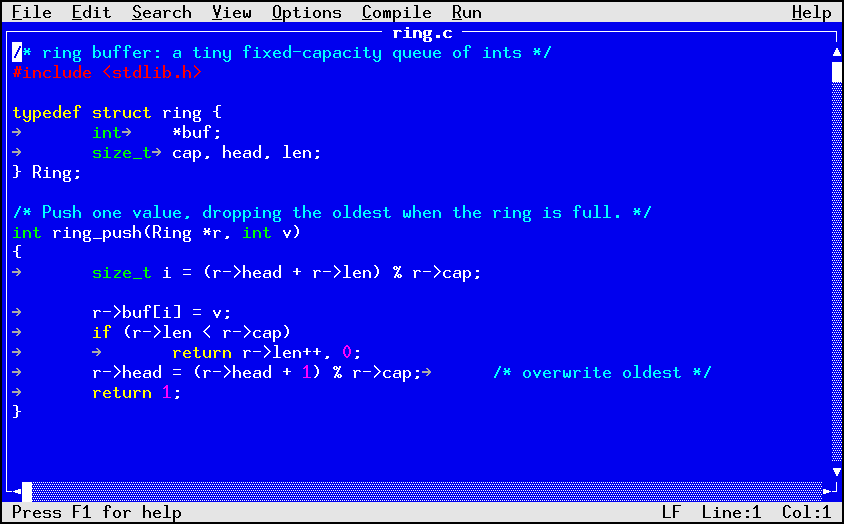
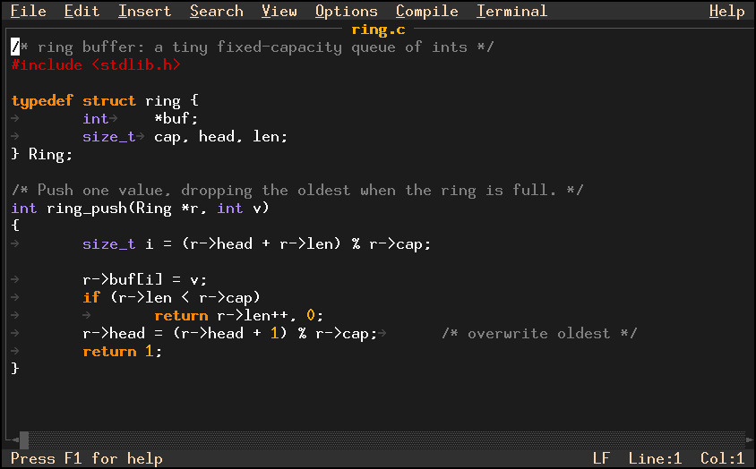

# vedit

A text editor for terminals, in one C file. It looks and works like the
MS-DOS EDIT program: a menu bar, a framed text area, and keys that need no
mode. Press F2 and it becomes a vi.

It draws with a fixed subset of ANSI codes and needs no terminfo, so it runs
over telnet or ssh to a plain terminal, a MUD client, or the Windows
console. The same source builds gvedit, the editor in its own window for a
desktop without a terminal.



## What it does

- **Two key personalities, one editor.** The MS-EDIT modeless keys and a full
  vi mode, switched with F2. A config file adds its own modes, which join the
  same F2 cycle as equals; WordStar and Emacs layouts ship as examples.
- **Syntax highlighting** for C, shell, JavaScript, HTML, Markdown, INI, diffs,
  git commits, and git blame, from a small FSM grammar you can extend.
- **Color themes** for the whole editor, the chrome and the syntax together, in
  16 or 256 colors. A theme can recolor the built-in languages in a few lines,
  and a spooky Halloween theme ships as an example (`examples/halloween.conf`).
- **Many files at once**, a file browser, two side-by-side panes, every line
  ending, and large files opened by memory-mapping rather than reading in full.
- **Crash recovery** from a journal kept beside the file, plus an Emacs-style
  lock so two editors warn about each other.
- **A command language**: a key binding can run a small program over typed
  positions, regions, registers, and marks, reaching across open files.
- **Other views** of the same buffer: a box-drawing draw mode, colored ANSI
  text art, CSV and TSV tables, and a hex dump.
- **Embedded terminals**: run a shell or a command in a buffer or the pane, with
  the mouse passed through to programs that ask for it.
- **A Maildir mail reader** with reply and reply-all, attachments, and RFC 2047
  encoded headers.
- **Mouse support** throughout: text, scrollbars, menus, dialogs, the hex and
  table views, and terminal programs.
- **Build, make, and run** your code from the editor, jumping to the first
  error, with tags and version-control integration alongside.



## Building

The only requirement is a C11 compiler on a POSIX system, or mingw-w64 for
Windows. There are no library dependencies.

```sh
make                    # build, linked as ./vedit
make install            # install to ~/.local/bin (PREFIX overrides)
make static             # static musl build, for dropping onto a server
make gvedit             # the window build (needs SDL3)
```

Prebuilt binaries are on the
[releases page](https://github.com/OrangeTide/vedit/releases): static Linux
builds for x86_64 and aarch64, and a Windows x86_64 build. The x86_64
archives also hold gvedit, the window build, with the SDL3 it needs
built in (Linux) or beside it as `SDL3.dll` (Windows).

## Quick start

```sh
vedit notes.txt
```

Type to insert text. The arrow keys, Home, End, PgUp, and PgDn move around.
Hold Shift while moving to select.

| Key | Action |
|---|---|
| Ctrl-S | save |
| Ctrl-Q | quit (asks about unsaved changes) |
| Ctrl-Z, Ctrl-Y | undo, redo |
| Ctrl-C, Ctrl-X, Ctrl-V | copy, cut, paste |
| Ctrl-F, Ctrl-R | find, replace |
| F10 | open the menu bar |
| F1 | show the keys |
| F2 | switch between the EDIT keys and the vi keys |

## Key modes

The EDIT keys and the vi keys are the two built-in modes, and F2 cycles
between them. A config file can add its own modes by binding keys, and they
join the same F2 cycle as equals. A complete WordStar layout ships as an
example:

```ini
[include]
    path = /usr/share/vedit/examples/wordstar.conf
[keys]
    modes = msedit wordstar
```

F2 now steps msedit then wordstar, and in the WordStar mode vedit edits with
the cursor diamond, the Ctrl-K / Ctrl-Q / Ctrl-O prefixes, blocks, and
markers. F1 shows that mode's own keys, carried in the same file. A simple
Emacs layout ships the same way in `examples/emacs.conf`. The
[configuration chapter](docs/05-configuration.md) has the binding syntax.

## Manual

The manual is in `docs/`, in reading order:

1. [Getting started](docs/01-getting-started.md): the screen, opening,
   saving, quitting, the menu bar, help
2. [Editing](docs/02-editing.md): moving, selecting, clipboard, undo,
   find and replace, with the EDIT keys
3. [Files and buffers](docs/03-files.md): the file browser, several files
   at once, two panes, line endings, crash recovery, the lock file,
   large files
4. [View settings](docs/04-view.md): line numbers, word wrap, tabs and
   indentation, color schemes, syntax highlighting
5. [Configuration](docs/05-configuration.md): the config file, every key
   setting, and custom keymaps
6. [The command language](docs/06-command-language.md): the programs a key
   binding can run, with positions, regions, registers, marks, and
   cross-file edits
7. [The vi keys](docs/07-vi.md): the complete list of what the vi
   personality implements, for readers who do not know vi
8. [Tools](docs/08-tools.md): compile, make, and run; terminals inside the
   editor; the pane; tags; version control
9. [Other views](docs/09-views.md): draw mode, color text art, CSV tables,
   the hex dump, mail
10. [Terminals and platforms](docs/10-terminals.md): frame styles, color
    depth, slow links, gvedit, Windows
11. [Advanced](docs/11-advanced.md): syntax grammars, themes, other version
    control systems, embedding in a host, build-time knobs
12. [Showcase](docs/12-showcase.md): examples and pictures

[Developing](docs/developing.md) covers tests, CI, screenshots, and
releases. `man vedit` is the terse reference for options, environment
variables, and files.

## How it was made

This project was written primarily with Claude, mostly Claude Opus 4.8 and
Claude Fable 5.1, working from the author's design decisions and review in
Claude Code. The tests, screenshots, and documentation were produced the same
way.
